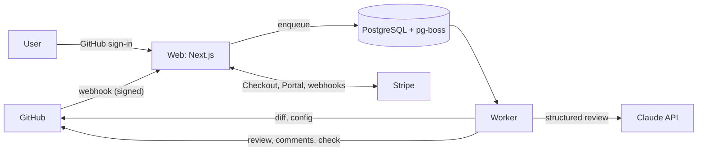

# CodeReviewer

AI code review for GitHub pull requests, powered by Claude. Install the GitHub App, open a pull request, and get a review in minutes: a summary of the change, comments on the exact lines that need attention, and one-click suggested fixes.

CodeReviewer is a complete SaaS: GitHub App, review engine, dashboard, Stripe billing, marketing site, and documentation. Run it as a paid service or self-host it without billing.

## Features

- **Line-level findings** with severity (critical, major, minor, nit), category, explanation, and GitHub suggestion blocks.
- **Summary and walkthrough** at the top of every review.
- **Incremental reviews**: only commits pushed since the last review, with automatic fallback to a full review after a force push.
- **Comment commands**: `@codereviewer review`, `@codereviewer full review`, `@codereviewer help`.
- **Merge gates**: optional request-changes reviews and a `CodeReviewer` check run for branch protection.
- **Per-repo config** in `.codereviewer.yaml` (profiles, language, path filters, path instructions). Reads `.coderabbit.yaml` for easy migration.
- **Safe by default**: verified webhooks, idempotent processing, config read from the base branch for fork PRs, PR content treated as untrusted, no source code stored.
- **Plans and quotas**: Free, Pro, and Team plans with Stripe Checkout and the Customer Portal. Billing switches off cleanly for self-hosting.

## How it works



See [docs/architecture.md](docs/architecture.md) for the full design.

## Quick start (local development)

Requirements: Node.js 22.13+, 24, or 26+ (26 recommended), Docker, a GitHub account, and an Anthropic API key.

```bash
npm install
```

```bash
cp .env.example .env
```

```bash
docker compose up -d postgres
```

```bash
npm run db:migrate
```

Create a GitHub App for development. GitHub must reach your webhook, so expose port 3000 with a tunnel (for example `cloudflared tunnel --url http://localhost:3000`), then register the app against the tunnel URL. The script prints the six `GITHUB_*` values for `.env`:

```bash
npm run github-app:create -- --url https://your-tunnel.example.com --private
```

Set `APP_URL` to the tunnel URL and add `ANTHROPIC_API_KEY`, then run the web app and the worker in two terminals:

```bash
npm run dev
```

```bash
npm run dev:worker
```

Open the app, sign in with GitHub, install the app on a test repository, and open a pull request.

To check the model integration on its own, without GitHub or a database:

```bash
ANTHROPIC_API_KEY=sk-ant-... npm run smoke:review
```

## Deploy

One Docker image runs both processes: the web server (default command) and the worker (`node dist/worker/index.mjs`). Migrations run with `node dist/db/migrate.mjs`.

- **Docker Compose** on any VM: `docker compose up -d --build`
- **Render**: the [render.yaml](render.yaml) blueprint creates the web service, worker, and database
- **Fly.io, Railway, ECS, Kubernetes**: any host that runs a container and a PostgreSQL database

[docs/deployment.md](docs/deployment.md) covers the GitHub App, Stripe, environment variables, and each host step by step. Before charging customers, work through [docs/launch-checklist.md](docs/launch-checklist.md).

## Configuration

Repositories configure reviews with an optional `.codereviewer.yaml`. See [examples/.codereviewer.yaml](examples/.codereviewer.yaml), the `/docs` page of a running instance, or the JSON Schema in [schema/codereviewer.schema.json](schema/codereviewer.schema.json) (also served at `/schema.json`).

Operator settings are environment variables, documented in [.env.example](.env.example). Plans and prices live in [src/lib/billing/plans.ts](src/lib/billing/plans.ts).

## Project structure

```text
src/
  app/                 Next.js routes: marketing site, dashboard, API routes
  components/          Shared UI
  db/                  Drizzle schema, client, migration runner
  lib/
    auth/              GitHub OAuth sign-in and sessions
    billing/           Plans and Stripe integration
    config/            .codereviewer.yaml schema, loader, path filters
    github/            GitHub App client, webhook handlers, commands
    review/            Review engine: diff parsing, prompts, Claude client, findings, formatting
  worker/              Queue consumer and maintenance jobs
drizzle/               SQL migrations
tests/                 Vitest suites (in-memory Postgres via PGlite, fake GitHub and model)
scripts/               GitHub App creation, schema generation, live smoke test
examples/              Example configs, including CodeRabbit files used for compatibility tests
docs/                  Architecture, deployment, launch checklist
```

## Scripts

| Command | Purpose |
| --- | --- |
| `npm run dev` / `npm run dev:worker` | Web app and worker in watch mode |
| `npm run build` | Production build of the web app and worker bundle |
| `npm test` | Unit and integration tests |
| `npm run lint` / `npm run typecheck` / `npm run format:check` | Static checks (all run in CI) |
| `npm run db:generate` / `npm run db:migrate` | Create and apply migrations |
| `npm run schema:generate` | Regenerate the config JSON Schema |
| `npm run github-app:create` | Register a GitHub App from the manifest |
| `npm run smoke:review` | One live review against Claude with a sample diff |

## Tech stack

Next.js 16, React 19, TypeScript, Tailwind CSS 4, PostgreSQL with Drizzle ORM, pg-boss, Octokit, the Anthropic TypeScript SDK, Stripe, Vitest.

## License

Proprietary. See [LICENSE.md](LICENSE.md). This repository began as a CC0 list of CodeRabbit resources, archived in [docs/legacy/](docs/legacy/), which keeps its original license.
