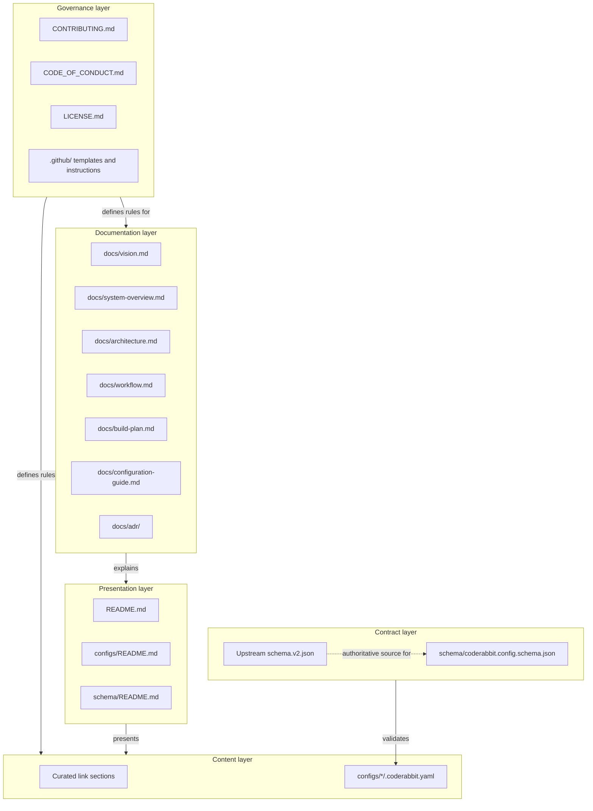
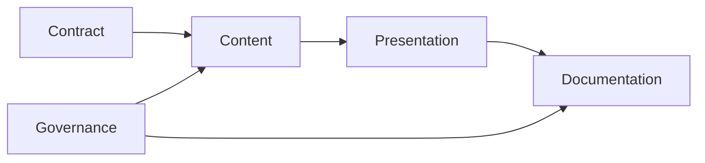

# Architecture

## Scope

This document describes the architecture of the **awesome-coderabbit repository** — a documentation system, not an application. It has no runtime, but it does have layers, boundaries, dependency rules, and a validation contract. Treating it as a system is what keeps it maintainable past the first fifty links.

The architecture follows a layered model with explicit boundaries and one-directional dependencies. The governing decision is recorded in [`adr/ADR-0001-repository-architecture.md`](adr/ADR-0001-repository-architecture.md).

---

## Layers



### Layer 1 — Contract

**Responsibility:** define what a valid configuration example looks like.

- `schema/coderabbit.config.schema.json` — the curated, strict subset used in CI.
- The upstream `schema.v2.json` — the authoritative definition, referenced by URL, never vendored.

**Rules:**

- The contract layer depends on nothing inside this repository.
- A field enters the local schema only when an example uses it.
- The upstream schema is never copied into the repository. Copying it guarantees drift; see [`adr/ADR-0002-configuration-validation.md`](adr/ADR-0002-configuration-validation.md).

### Layer 2 — Content

**Responsibility:** hold the material a reader actually came for.

- Curated links, grouped by the question they answer.
- Configuration examples, one directory per stack.

**Rules:**

- Every link carries exactly one line of description.
- A link appears in exactly one section. Cross-cutting resources are placed where a reader would look first.
- Every configuration example must be committable as-is, with no placeholder values left to fill in.
- No secrets, internal hostnames, private repository names, or customer identifiers.

### Layer 3 — Presentation

**Responsibility:** make content findable in under thirty seconds.

- `README.md` — the entry point, the table of contents, and the grouped sections.
- Directory-level READMEs for `configs/` and `schema/`.

**Rules:**

- The README owns navigation. It does not own explanation — long-form reasoning belongs in `docs/`.
- Long reference tables are wrapped in `<details>` so the page stays scannable on GitHub.
- No section exists to look complete. An empty section is deleted, not padded.

### Layer 4 — Documentation

**Responsibility:** let a second maintainer take over without asking questions.

- Vision, system overview, architecture, workflow, build plan, configuration guide.
- Architecture decision records.

**Rules:**

- Documentation describes intent and structure, and never paraphrases CodeRabbit behavior that could change. Behavior is linked, not restated.
- Diagrams are Mermaid, inline, and text-diffable. No binary images.
- ADRs are immutable once accepted; a changed decision becomes a new ADR that supersedes the old one.

### Layer 5 — Governance

**Responsibility:** make the rules enforceable rather than aspirational.

- Contribution rules, the review checklist, conduct expectations, licensing.
- Pull request template and repository instructions for AI assistants.

**Rules:**

- Every rule stated in governance is either automatically checked or present on the human review checklist. A rule that is neither is deleted.
- Governance changes require an explanation in the pull request description.

---

## Dependency rules



| Rule | Rationale |
| --- | --- |
| Dependencies point in one direction only | A schema change must never require a README edit to stay valid |
| The contract layer has no inbound repository dependencies | It can be validated in isolation |
| Presentation may reference content and documentation; content may not reference presentation | A configuration example must make sense on its own, outside this repository |
| No layer reaches two levels up | Prevents the README becoming the place where rules are defined |
| ADRs are append-only | The decision history stays auditable |

---

## Directory structure

```
awesome-coderabbit/
├── README.md                          # Presentation: entry point and curated sections
├── .coderabbit.yaml                   # Governance: this list is reviewed by the tool it documents
├── CONTRIBUTING.md                    # Governance: how to add resources
├── CODE_OF_CONDUCT.md                 # Governance: conduct expectations
├── LICENSE.md                         # Governance: CC0 for this repo's own content
│
├── .github/
│   ├── copilot-instructions.md        # Governance: rules for AI assistants in this repo
│   └── pull-request-template.md       # Governance: the contribution checklist
│
├── configs/                           # Content: runnable configuration examples
│   ├── README.md
│   ├── minimal/.coderabbit.yaml
│   ├── javascript/.coderabbit.yaml
│   ├── typescript/.coderabbit.yaml
│   ├── python/.coderabbit.yaml
│   ├── go/.coderabbit.yaml
│   └── mixed-stack/.coderabbit.yaml
│
├── schema/                            # Contract: validation
│   ├── README.md
│   └── coderabbit.config.schema.json
│
└── docs/                              # Documentation
    ├── vision.md
    ├── system-overview.md
    ├── architecture.md
    ├── workflow.md
    ├── build-plan.md
    ├── configuration-guide.md
    └── adr/
        ├── ADR-0001-repository-architecture.md
        └── ADR-0002-configuration-validation.md
```

### Naming conventions

Inherited from the governing repository standards and applied without exception:

| Element | Convention | Example |
| --- | --- | --- |
| Directories | kebab-case | `mixed-stack/` |
| Documentation files | kebab-case | `system-overview.md` |
| ADR files | `ADR-NNNN-kebab-case.md` | `ADR-0001-repository-architecture.md` |
| Configuration files | exact upstream name | `.coderabbit.yaml` |
| Schema files | dotted, lowercase | `coderabbit.config.schema.json` |
| Root governance files | SCREAMING_SNAKE, by ecosystem convention | `CONTRIBUTING.md` |

Configuration examples keep the literal filename `.coderabbit.yaml` inside a stack directory so a reader can copy the file to a repository root without renaming it. The directory carries the stack name; the file carries the name CodeRabbit requires.

---

## Quality attributes

How the architecture serves each attribute, and how it is verified.

| Attribute | Mechanism | Verification |
| --- | --- | --- |
| Correctness | Two-stage schema validation on every example | CI on every pull request |
| Freshness | Link reachability checks; scheduled runs, not only on PRs | CI, plus an automatically opened issue on failure |
| Browsability | Grouped sections, collapsible tables, one-line descriptions | Human review against the checklist |
| Maintainability | Layered structure, one-directional dependencies, ADRs | Architectural review on structural changes |
| Safety | No executable content; secret scanning; untrusted-input posture | CI, plus review |
| Portability | Markdown, YAML, JSON only; no build step | Renders correctly on GitHub with no tooling |
| Extensibility | New stack means a new directory plus a README row | No other file changes required |

---

## Security posture

The repository stores no credentials and runs no submitted code, which removes most of the attack surface. What remains is treated under a zero-trust model.

| Risk | Control |
| --- | --- |
| Malicious or misleading link in a contribution | Human verification of destination, not only HTTP status |
| Secret accidentally committed in a config example | Secret scanning in CI; review checklist item |
| Configuration example that weakens a consumer's review posture | Review requirement: no example may disable security analyzers or set a check to `off` without a comment explaining why |
| Supply-chain risk from CI actions | Actions pinned to a commit SHA; least-privilege `permissions` blocks |
| Dependency confusion via a copied schema | Upstream schema referenced by URL and never vendored |
| Prompt injection through contributed text | Contributed content is data. Text in an example or link description is never treated as an instruction to tooling or to an AI assistant reading the repository |

---

## Extension points

Adding to the repository should touch as few files as possible.

| Extension | Files to change |
| --- | --- |
| New link | `README.md` — one line in the correct section |
| New stack example | `configs/<stack>/.coderabbit.yaml`, a row in `configs/README.md`, a row in the README table |
| New schema field | `schema/coderabbit.config.schema.json`, plus at least one example that uses it |
| New documentation topic | A file in `docs/`, plus a row in the README's repository-documentation table |
| Structural change | An ADR first, then the change |

---

## Related documents

- [`vision.md`](vision.md) — Purpose, principles, non-goals.
- [`system-overview.md`](system-overview.md) — How CodeRabbit works, and the mapping to this list.
- [`workflow.md`](workflow.md) — Contribution and CI workflow.
- [`build-plan.md`](build-plan.md) — Building this repository from scratch.
- [`adr/ADR-0001-repository-architecture.md`](adr/ADR-0001-repository-architecture.md) — The layered-architecture decision.
- [`adr/ADR-0002-configuration-validation.md`](adr/ADR-0002-configuration-validation.md) — The two-schema validation decision.
