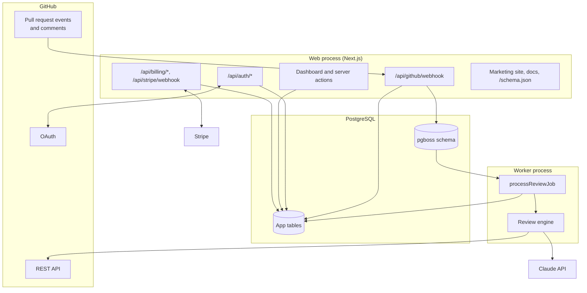

# Architecture

## Components

## Review lifecycle

1. **Webhook.** `POST /api/github/webhook` verifies the `X-Hub-Signature-256` HMAC, records the delivery ID (duplicates return 200 without work), and dispatches by event. `installation` and `installation_repositories` keep accounts and repositories in sync. `pull_request` (opened, reopened, synchronize, ready_for_review) and `issue_comment` commands enqueue a job.
2. **Queue.** pg-boss stores jobs in PostgreSQL. The queue uses the `stately` policy keyed by repository and PR number, so a pull request has at most one queued and one running review; extra pushes while queued collapse into one job, which always reviews the latest head.
3. **Gate.** The worker checks the account is installed and not suspended, the repository is enabled, and the plan quota has room. Over quota, it leaves one comment per pull request per month.
4. **Config.** `.codereviewer.yaml` (or a compatible `.coderabbit.yaml`) is read from the head commit, or from the base commit when the pull request comes from a fork, so outside contributors cannot change review rules. Invalid fields fall back to defaults and are reported in the review.
5. **Diff.** For a follow-up review, the worker compares the last reviewed commit to the new head. If that commit is no longer an ancestor (force push), it reviews the whole pull request. Files go through built-in and configured path filters. Oversized, binary, and deleted files are listed, never truncated.
6. **Model.** Files are rendered with explicit new-file line numbers and split into batches of about 120,000 characters. Each batch is one Claude request with a fixed, cacheable system prompt, structured output validated against a Zod schema, adaptive thinking, and server-side refusal fallback. Batches run three at a time. A declined batch is reported in the review while the rest are posted; any other failure fails the job so it is retried.
7. **Findings.** Each finding is checked against the diff: the line must be commentable, and a multi-line range must stay within one hunk (otherwise the range and its suggestion are dropped). Findings are filtered by profile, de-duplicated, sorted by severity, and capped at `max_comments`; the rest go into the review body.
8. **Post.** One pull request review carries the summary, walkthrough, and inline comments. If GitHub rejects an inline position (a push raced the review), the review is re-posted with every finding in the body. A `CodeReviewer` check run tracks progress and fails only when `request_changes` is on and a critical or major finding exists.
9. **Record.** The review row stores metadata only: status, counts, summary, token usage, timing, and the GitHub review ID. Retries of the same job update the same row.

## Data model

| Table | Purpose |
| --- | --- |
| `users` | People who signed in with GitHub |
| `sessions` | SHA-256 hashes of session tokens, with expiry |
| `accounts` | GitHub users or organizations with the app installed; plan and Stripe state |
| `memberships` | Which users can see which accounts (from GitHub's installation access at sign-in) |
| `repositories` | Repositories in each installation, with the dashboard toggle and an `active` flag |
| `reviews` | One row per review attempt, used for history and quota counting |
| `webhook_deliveries`, `stripe_events` | Idempotency keys, pruned by the daily maintenance job |

Quotas count `completed` reviews since the first of the current month (UTC). Removing a repository from the installation marks it inactive rather than deleting it, so usage cannot be reset by removing and re-adding a repository.

## Authentication and authorization

- Sign-in uses the GitHub App's OAuth credentials with a random `state` cookie. The callback fetches the user and `GET /user/installations`, upserts accounts, and replaces the user's memberships. The user token is used only during the callback and never stored.
- Sessions are 32 random bytes in an HTTP-only, `SameSite=Lax` cookie; the database stores only the hash.
- Every dashboard query and server action checks membership. Billing routes also verify the request's `Origin`.
- `next` redirects after sign-in accept only same-origin relative paths.

## Prompt safety

The system prompt tells the model that everything inside `<pull_request>` and `<files>` is untrusted and must not be followed, and to flag attempts to manipulate an automated reviewer. Repository-owner guidance (`instructions`, `path_instructions`) is placed in separate `<review_guidance>` blocks. The model's output is constrained to a schema, and the only side effect is a review on the same pull request.

## Key decisions

| Decision | Why | Alternatives considered |
| --- | --- | --- |
| Next.js monolith plus a separate worker | One codebase and image; reviews take minutes and must not run inside request handlers | Serverless functions (time limits), separate API service (more to deploy) |
| PostgreSQL as the queue (pg-boss) | One stateful dependency; transactional with app data; singleton keys per PR | Redis with BullMQ (extra service), SQS (cloud lock-in) |
| GitHub App for both access and sign-in | Fine-grained repository permissions and installation-scoped access lists | OAuth App plus personal tokens (broader access) |
| Narrow `GitHubPort` and `ReviewModel` interfaces | The engine is tested end to end with in-memory fakes | Mocking HTTP (brittle) |
| Structured output instead of free text | Every finding has a path, line, and severity that can be validated before posting | Parsing Markdown (fragile) |
| Store metadata, not code | Smaller compliance surface and a clear privacy promise | Caching diffs for re-runs |
| Flat per-account plans | Simple to explain and bill; no seat counting | Per-seat pricing (needs active-developer tracking) |
