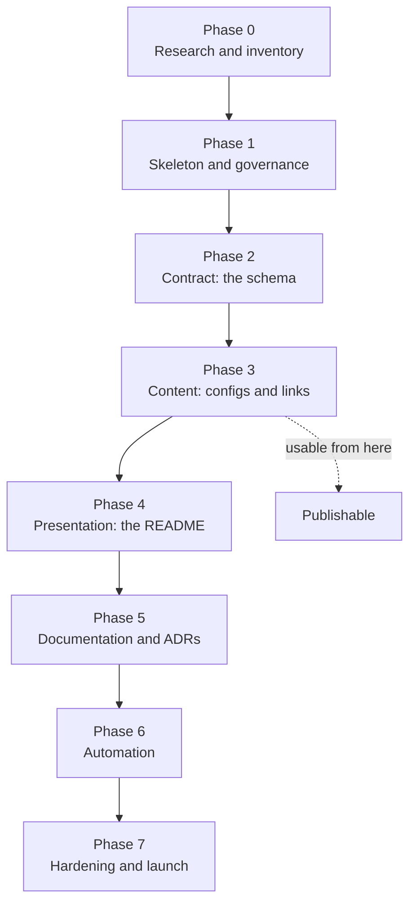

# Build plan

A phase-by-phase plan for building this repository from an empty directory. Each phase has a goal, deliverables, acceptance criteria, and a stated dependency. A single developer can complete the whole thing in roughly two focused days; the phases are ordered so that the repository is useful after Phase 3 and merely gets better after that.

The purpose of writing it down is that the build order is not obvious. Building the README first feels natural and is wrong: without the schema and the examples, the README has nothing to link to, and every section gets rewritten twice.

---

## Build order

---

## Phase 0 — Research and inventory

**Goal:** know what exists before writing anything.

**Depends on:** nothing.

**Deliverables**

- The complete official documentation URL map. Pull it from `https://docs.coderabbit.ai/sitemap.xml` or `https://docs.coderabbit.ai/llms.txt` rather than clicking through the site — the sidebar hides pages, the sitemap does not.
- The current configuration schema, read in full, from `https://coderabbit.ai/integrations/schema.v2.json`. Note every field name, type, enum, and default that an example might use.
- A candidate link list: official resources, community tutorials, videos, media coverage, reviews (favorable and critical), and open source repositories with a public `.coderabbit.yaml`.
- A read of the vendor-maintained [awesome-coderabbit](https://github.com/coderabbitai/awesome-coderabbit) so this list complements it rather than duplicating it.

**Acceptance criteria**

- Every documentation URL in the inventory came from the sitemap, not from memory.
- Every schema field intended for an example has its exact name, type, and default recorded.
- No link is in the inventory without having been opened.

**Trap to avoid:** writing configuration examples from recalled field names. Names change, and a plausible-looking invalid field is worse than a missing one, because it fails silently at review time.

---

## Phase 1 — Skeleton and governance

**Goal:** decide the shape and the rules before content exists to argue about.

**Depends on:** Phase 0.

**Deliverables**

- The directory tree from [`architecture.md`](architecture.md), with empty placeholders.
- `LICENSE.md` — CC0 for the repository's own content.
- `CODE_OF_CONDUCT.md`.
- A first draft of `CONTRIBUTING.md`: quality bar, description style, where each kind of link goes, the checklist.
- `.github/pull-request-template.md` mirroring the checklist.
- `.github/copilot-instructions.md` so AI assistants working in the repository follow the same rules.
- `docs/vision.md`, including the non-goals. Write the non-goals early; they are what stop scope drift later.

**Acceptance criteria**

- Directory and file names are kebab-case, with the documented exceptions.
- The non-goals list is specific enough to reject a real proposal.
- Every rule in `CONTRIBUTING.md` is one a check or a reviewer can actually apply.

---

## Phase 2 — Contract: the schema

**Goal:** make invalid examples impossible to merge.

**Depends on:** Phase 0 (the field inventory).

**Deliverables**

- `schema/coderabbit.config.schema.json` — draft 2020-12, covering the subset the examples will use, with `additionalProperties: false` on defined objects.
- `schema/README.md` explaining what the schema is for, what it is not, and how to validate with both Node and Python tooling.

**Acceptance criteria**

- The schema validates a known-good configuration and rejects each of: a misspelled field, an invalid `profile` value, a string where a number belongs, and a misspelled analyzer name.
- The upstream schema is referenced by URL and not vendored.
- Every enum in the schema matches upstream exactly.

**Why this precedes the examples:** an example written before the contract exists gets rewritten once the contract catches it. Writing the contract first makes each example correct on the first pass.

---

## Phase 3 — Content: configs and links

**Goal:** produce the material a reader came for. The repository is publishable at the end of this phase.

**Depends on:** Phase 2.

**Deliverables**

- Six configuration examples: `minimal`, `javascript`, `typescript`, `python`, `go`, `mixed-stack`. Build `minimal` first, then extend it — each stack example is the minimal one plus stack-specific path instructions, filters, and analyzers.
- `configs/README.md` with a selection table and the shared design choices.
- The curated link set, grouped and each with a one-line description.

**Acceptance criteria**

- Every example passes both schema checks.
- Every example is committable as-is, with no placeholder values.
- Every example's comments explain *why* a block is there, not what the YAML says.
- No secrets, internal hostnames, or private repository names anywhere.
- Every link has been opened and described in one line.

**Sequencing tip:** write the `mixed-stack` example last. It is the union of the others plus infrastructure concerns, and building it first produces something bloated that the single-language examples then get carved out of badly.

---

## Phase 4 — Presentation: the README

**Goal:** make everything findable in under thirty seconds.

**Depends on:** Phase 3.

**Deliverables**

- `README.md`: a one-paragraph explanation of CodeRabbit, a quick start with a minimal config inline, a table of contents, and the grouped sections.
- Long reference tables wrapped in `
` blocks.
- The documentation map, grouped by product surface rather than by URL order.
- A commands cheat sheet covering the commands people actually use.

**Acceptance criteria**

- The table of contents anchors all resolve.
- Every section has content; no section is padded to appear complete.
- Blank lines before every list and after every heading, so CommonMark renders correctly.
- A reader can reach a working configuration from the top of the page without leaving it.

---

## Phase 5 — Documentation and ADRs

**Goal:** make the project maintainable by someone who did not build it.

**Depends on:** Phase 4.

**Deliverables**

- `docs/system-overview.md` — how CodeRabbit works, and the mapping to the list's structure.
- `docs/architecture.md` — layers, dependency rules, quality attributes, security posture.
- `docs/workflow.md` — contribution lifecycle, checks, review checklist, cadence.
- `docs/configuration-guide.md` — field reference for the examples and validation instructions.
- `docs/build-plan.md` — this document.
- `docs/adr/ADR-0001-repository-architecture.md` and `ADR-0002-configuration-validation.md`.

**Acceptance criteria**

- Every Mermaid diagram renders on GitHub.
- No document paraphrases CodeRabbit behavior that could change; behavior is linked.
- Cross-links exist in both directions.
- Both ADRs state alternatives that were considered and rejected, with reasons.

---

## Phase 6 — Automation

**Goal:** enforce the rules rather than restate them.

**Depends on:** Phase 5.

**Deliverables**

- Six independent checks: markdown lint, link check, YAML parse, local schema, upstream schema, secret scan.
- A weekly scheduled link sweep that opens an issue per dead link.
- A `.coderabbit.yaml` for this repository itself — the list should be reviewed by the tool it documents.

**Acceptance criteria**

- Each check fails independently and names the problem.
- Actions are pinned to commit SHAs; top-level `permissions` is `contents: read`.
- No secrets are available to jobs that process pull request content.
- An upstream schema fetch failure warns rather than blocking a documentation fix.

---

## Phase 7 — Hardening and launch

**Goal:** survive contact with contributors.

**Depends on:** Phase 6.

**Deliverables**

- A dry-run contribution: add a link and an example as an outside contributor would, and fix whatever was unclear.
- Verification that every automated check fails when it should, by deliberately breaking each one once.
- Good-first-issue labels on the gaps identified in the roadmap.
- A submission to the upstream awesome-list index, if the project meets its criteria.

**Acceptance criteria**

- A first-time contributor can add a link without asking a question.
- Each check has been observed failing and then passing.
- `main` is green.

---

## Effort estimate

Ordered by value per hour, for a single developer.

| Phase | Effort | Notes |
| --- | --- | --- |
| 0 — Research | 3–4 h | The sitemap and schema reads dominate; do not shortcut them |
| 1 — Skeleton | 1–2 h | Mostly decisions, little typing |
| 2 — Schema | 2–3 h | Slow only if the field inventory from Phase 0 is incomplete |
| 3 — Content | 5–7 h | The bulk of the work; the mixed-stack example alone is 1–2 h |
| 4 — README | 2–3 h | Fast if Phase 3 produced good one-line descriptions |
| 5 — Documentation | 3–4 h | Diagrams take longer than the prose |
| 6 — Automation | 2–3 h | Six small checks, one schedule |
| 7 — Hardening | 1–2 h | Mostly deliberate breakage |

The order matters more than the estimates. Phases 2 and 3 in the wrong order roughly doubles Phase 3.

---

## Common failure modes

| Failure mode | Prevention |
| --- | --- |
| Writing the README first | Build the contract and content first; the README is a view over them |
| Configuration fields written from memory | Read the upstream schema in Phase 0 and quote it |
| Vendoring the upstream schema for convenience | Reference by URL; a copy is drift waiting to happen |
| Padding sections to look comprehensive | Delete empty sections; a short honest list beats a long padded one |
| Descriptions that restate the page title | Describe what the reader *gets*, in one line |
| Only listing favorable reviews | Include the critical ones; credibility is the whole asset |
| Governance rules nobody enforces | Every rule is either automated or on the review checklist |
| Structural changes without an ADR | Write the ADR first; the diff is the easy part |

---

## Related documents

- [`vision.md`](vision.md) — Why the project exists, and its non-goals.
- [`architecture.md`](architecture.md) — The structure this plan builds.
- [`workflow.md`](workflow.md) — How the repository operates once built.
- [`configuration-guide.md`](configuration-guide.md) — The reference behind Phase 3.
