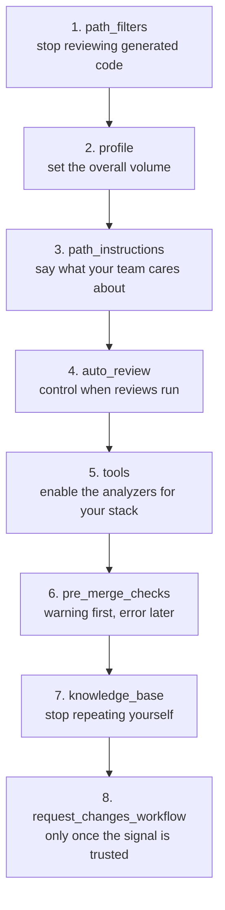

# Configuration guide

A practical guide to the `.coderabbit.yaml` examples in [`../configs/`](../configs/): which fields matter, in what order to tune them, and how to validate the result.

Field behavior can change. The authoritative source is always the [configuration reference](https://docs.coderabbit.ai/reference/configuration) and the [schema](https://coderabbit.ai/integrations/schema.v2.json). This guide explains *how to think about* the fields; it does not replace them.

---

## Where the file lives, and which one wins

The file is `.coderabbit.yaml` at the repository root. Two behaviors matter more than any field:

1. **The config on the branch under review is the one used.** A configuration change is therefore testable in the same pull request that introduces it — open the PR and read the resulting review.
2. **Pull requests from forks use the target branch's configuration.** A fork cannot redefine your review policy.

Precedence, highest to lowest:

| Layer | Notes |
| --- | --- |
| Repository `.coderabbit.yaml` | Version-controlled, reviewable, wins outright |
| Central shared YAML | One config across many repositories |
| Repository UI settings | Convenient, invisible in the diff |
| Organization UI settings | Defaults for the whole org |
| Product defaults | What you get with no config at all |

Set `inheritance: true` to merge unset values from the level above rather than falling through to defaults. Run `@coderabbitai configuration` on a pull request to print the resolved result annotated with the layer each value came from — this is the fastest way to answer "why is my setting being ignored".

---

## Tune in this order

Most teams change everything at once and cannot tell what helped. The order below moves the biggest lever first.



### 1. `reviews.path_filters` — the highest-impact field

Glob patterns choosing what gets reviewed. A leading `!` excludes, and exclusions are what you actually need: lockfiles, `dist/`, `vendor/`, generated protobuf, minified bundles, and snapshots produce findings nobody will act on, and they crowd out the ones that matter.

```yaml
reviews:
  path_filters:
    - "src/**"
    - "!**/*.lock"
    - "!**/dist/**"
    - "!**/*.pb.go"
    - "!**/node_modules/**"
```

These patterns also drive a sparse checkout, so excluding large generated directories makes reviews faster as well as quieter.

If you change one field and nothing else, change this one.

### 2. `reviews.profile` — overall volume

| Value | Behavior | Choose it when |
| --- | --- | --- |
| `quiet` | Only the most important findings | The team is already complaining about noise |
| `chill` | Balanced. The default | Starting out |
| `assertive` | More feedback, including nits | The team explicitly wants everything |

Change the profile before you start writing `path_instructions` to suppress things. Profile is a dial; instructions are surgery.

### 3. `reviews.path_instructions` — your team's actual review policy

Glob-scoped guidance, up to 20,000 characters per entry. This is where a generic reviewer becomes yours.

```yaml
reviews:
  path_instructions:
    - path: "server/**/*.ts"
      instructions: |
        - Every route handler must validate untrusted input before use.
        - Flag string-concatenated SQL; require parameterized queries.
        - Errors returned to clients must not leak stack traces.
```

What works:

- **Write policy, not style.** Formatting belongs to your formatter. Use instructions for the things a senior reviewer would push back on.
- **Be specific and checkable.** "Flag `model.save()` without a preceding `full_clean()`" produces action. "Write clean code" produces nothing.
- **State the negatives too.** "Do not suggest type annotations in this codebase" prevents a recurring, unwanted suggestion.
- **Scope narrowly.** `**/api/**/*.ts` catches the boundary code where the rules actually apply; `**/*.ts` dilutes them.

Shortcut: run `@coderabbitai emit path instructions` and CodeRabbit opens a pull request adding instructions it has suggested over the past week, merged into your existing file without overwriting what is there.

### 4. `reviews.auto_review` — when reviews run

```yaml
reviews:
  auto_review:
    enabled: true
    auto_incremental_review: true          # re-review on each push
    drafts: false                          # skip drafts
    ignore_title_keywords: ["wip"]
    labels: ["!skip-review"]               # "!" excludes
    base_branches: ["main", "release/.*"]  # regex accepted
    auto_pause_after_reviewed_commits: 10  # 0 disables pausing
```

| Field | Use it for |
| --- | --- |
| `labels` | An opt-out escape hatch (`!skip-review`), or opt-in review when `enabled: false` |
| `base_branches` | Long-lived release branches; accepts regex, `.*` matches everything |
| `auto_pause_after_reviewed_commits` | Stopping a long-running branch from consuming the whole allowance |
| `description_keyword` | Opt-in reviews: with `enabled: false`, review only when this appears in the description |

`@coderabbitai pause` and `resume` do the same thing per pull request, without a config change.

### 5. `reviews.tools` — the analyzers

Sixty-plus static analyzers and SAST tools ship built in. Enable the ones for your stack and, importantly, leave the security ones on.

```yaml
reviews:
  tools:
    eslint:
      enabled: true
      config_file: ".eslintrc.json"   # skip discovery, use this for every file
    ruff:
      enabled: true
    golangci-lint:
      enabled: true
    gitleaks:
      enabled: true
    semgrep:
      enabled: true
```

Notes:

- Most tools take only `enabled`. Some also accept `config_file` — ESLint, Semgrep, SwiftLint, PMD, Detekt, SQLFluff, golangci-lint among them — and PHPStan takes a `level`.
- Turning a linter off in CodeRabbit does not turn it off in your CI. Disable it here when the findings duplicate what your pipeline already reports on the same lines.
- `ast-grep` is the escape hatch for rules no linter covers: point `rule_dirs` at your own AST patterns and they become review findings.

### 6. `reviews.pre_merge_checks` — gates

Each check has a `mode`: `off`, `warning`, or `error`. With `request_changes_workflow` enabled, `error` can block the pull request.

```yaml
reviews:
  pre_merge_checks:
    title:
      mode: "warning"
      requirements: "Conventional Commit style with a scope. Under 72 characters."
    description:
      mode: "warning"
    issue_assessment:
      mode: "warning"
    docstrings:
      mode: "warning"
      threshold: 70
    custom_checks:
      - name: "Migration safety note"
        mode: "warning"
        instructions: |
          Fail if the pull request adds or edits a file under a migrations/ directory and the
          description has no rollout and rollback section. Pass otherwise.
```

Two rules learned the hard way:

- **Start at `warning`.** A gate that blocks on day one gets switched off on day three, along with the rest of the config.
- **Write custom check instructions deterministically.** "Fail if X and not Y. Pass otherwise." A vague check produces inconsistent results and destroys trust in the gate. Limits: 50 characters for the name, 10,000 for the instructions, 50 checks.

### 7. `knowledge_base` — stop repeating yourself

```yaml
knowledge_base:
  learnings:
    scope: "auto"          # local for public repos, global for private
    approval_delay: 1      # days for an admin to reject; 0 applies immediately
  code_guidelines:
    enabled: true
    filePatterns:
      - "**/AGENTS.md"
      - "docs/standards/**/*.md"
      - files: "docs/standards/security/**/*.md"
        applyTo: "**/*.{tf,yaml,yml}"
  web_search:
    enabled: true
```

`code_guidelines` is the field most teams miss. If you already keep standards in `AGENTS.md`, `CLAUDE.md`, `.cursor/rules`, or `CONTRIBUTING.md`, CodeRabbit will read them as review criteria — several of those paths are picked up by default. The object form pairs a guideline document with the paths it governs, so security standards apply to infrastructure files rather than to everything.

Set `knowledge_base.opt_out: true` to disable every feature that requires retention, which also deletes stored knowledge base data.

### 8. `reviews.request_changes_workflow` — the last switch

With this on, CodeRabbit behaves like a blocking reviewer and approves once its threads are resolved, the latest commit has been reviewed, and no pre-merge check is failing. On GitLab, all discussions must be resolved.

Turn it on last, after the noise is gone and the gates have run at `warning` long enough that the team trusts them. Turning it on first is the most common way to make a team hate the tool.

---

## Fields worth knowing about

| Field | Why it matters |
| --- | --- |
| `tone_instructions` | 250 characters that set the review voice. "Be concise, cite the risk, prefer one concrete fix" changes the output noticeably |
| `reviews.high_level_summary_instructions` | Reshape the summary into your release-note format |
| `reviews.sequence_diagrams` | Diagrams in the walkthrough; expensive on large PRs, valuable on complex ones |
| `reviews.estimate_code_review_effort` | Sets reviewer expectations before they open the diff |
| `reviews.labeling_instructions` | Automatic, rule-based labels — useful for routing in a monorepo |
| `reviews.finishing_touches.*` | Docstrings, unit tests, simplify, autofix, fix CI, resolve merge conflict |
| `reviews.slop_detection` | Flags low-quality or spam pull requests; relevant for public repositories |
| `reviews.post_merge_actions` | Prompt-driven follow-up work after merge; max five |
| `reviews.enable_prompt_for_ai_agents` | Adds a machine-readable fix prompt to each finding, for coding agents |
| `language` | Reviews and chat in another language, by ISO code |

---

## Validation

Two checks. Both matter, and passing one does not imply the other.

### Against the curated schema in this repository

Catches typos, bad enums, wrong types, and unknown keys.

```bash
# Node
npx --yes ajv-cli@5 validate --spec=draft2020 \
  -s schema/coderabbit.config.schema.json \
  -d "configs/*/.coderabbit.yaml"

# Python
check-jsonschema --schemafile schema/coderabbit.config.schema.json configs/*/.coderabbit.yaml
```

### Against the upstream schema

Catches fields CodeRabbit would actually reject.

```bash
check-jsonschema \
  --schemafile https://coderabbit.ai/integrations/schema.v2.json \
  configs/*/.coderabbit.yaml
```

### In your editor

Keep the schema comment on the first line of every config and the YAML extension will autocomplete field names and flag invalid enums as you type:

```yaml
# yaml-language-server: $schema=https://coderabbit.ai/integrations/schema.v2.json
```

CodeRabbit also ships a [YAML validator](https://docs.coderabbit.ai/configuration/yaml-validator) if you would rather not install anything.

---

## Troubleshooting

| Symptom | Likely cause |
| --- | --- |
| "My config is being ignored" | Reviewing the wrong branch, or a higher layer overriding it. Run `@coderabbitai configuration` |
| Reviews are too noisy | `path_filters` missing exclusions; try `profile: "quiet"` next |
| No review appeared | Draft PR with `drafts: false`; a title keyword or label filter matched; base branch not listed; allowance exhausted — check with `@coderabbitai rate limit` |
| Reviews stopped mid-branch | `auto_pause_after_reviewed_commits` reached. `@coderabbitai resume` |
| A gate is blocking unexpectedly | A `pre_merge_checks` mode is `error` and `request_changes_workflow` is on |
| Same suggestion every review | Capture it as a `path_instruction` or in a code guidelines file |
| Findings on generated files | Add the pattern to `path_filters` with a `!` prefix |
| Slow reviews on large PRs | Expected; narrow `path_filters`, split the PR, or disable `sequence_diagrams` |

---

## Related documents

- [`../configs/README.md`](../configs/README.md) — The examples and how to pick one.
- [`../schema/README.md`](../schema/README.md) — What the local schema does and does not do.
- [`system-overview.md`](system-overview.md) — How configuration resolution fits the review pipeline.
- [`adr/ADR-0002-configuration-validation.md`](adr/ADR-0002-configuration-validation.md) — Why two schemas.
