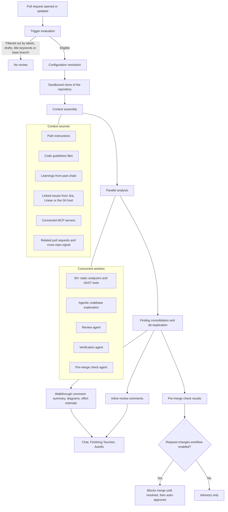
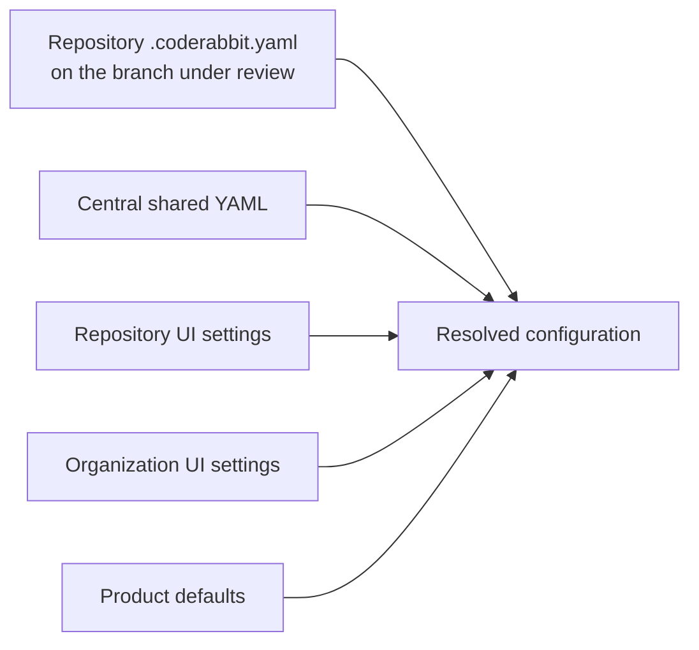
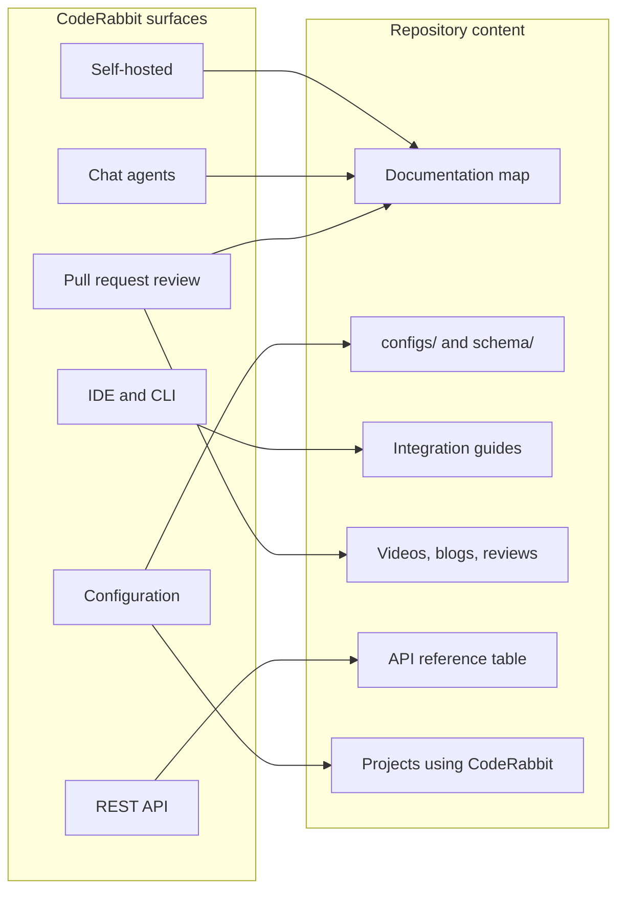
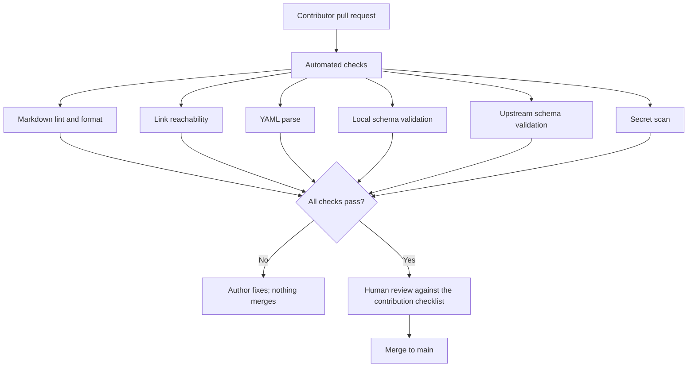

# System overview

Two systems are described here. The first is CodeRabbit — the product this list documents. The second is this repository, whose structure follows directly from the first. Understanding the review pipeline is what makes the section layout of the README non-arbitrary.

---

## Part 1 — How CodeRabbit works

### Summary

CodeRabbit is not a single prompt against a diff. Each review runs as an orchestrated pipeline: the repository is cloned into a sandbox, dozens of static analyzers run in parallel with agentic exploration of the surrounding code, several specialized agents work concurrently, and the merged result is posted as a walkthrough comment plus line-level findings.

### Review pipeline

### Configuration resolution

Configuration is layered. Understanding the order is the difference between a config that works and one that appears to be ignored.

Precedence runs highest to lowest in that order: the repository YAML wins, then central configuration, then repository UI settings, then organization UI settings, then defaults. With `inheritance` enabled, unset values are merged from the level above instead of falling straight through to defaults.

Two facts that cause most confusion:

- The configuration used for a review is the one **on the feature branch being reviewed**, not the one on the default branch. A config change is therefore testable in the pull request that introduces it.
- Pull requests from forks use the **target branch's** configuration, which is what prevents a fork from redefining review policy.

Run `@coderabbitai configuration` on any pull request to print the resolved result, annotated with the layer each value came from.

### Surfaces

The same engine is reachable from several places, and the list is organized around them.

| Surface | When it runs | Typical use |
| --- | --- | --- |
| Pull request | On open and on each push | The primary review loop |
| IDE extension | On demand, before committing | Catch findings before they are public |
| CLI | On demand or in a pipeline | Reviewing agent-authored changes; headless CI use |
| Slack agent | From a thread | Investigate, plan, and open a pull request from chat |
| Discord agent | From a public channel | Open source community workflows |
| REST API | Programmatic | Metrics, learnings, roles, seat management, reports |
| Triage | Continuous | Working a findings queue across repositories |

### Why noise is a configuration problem

The recurring complaint about AI review tools is volume. In CodeRabbit's case the levers are specific, which is why this repository ships opinionated examples rather than prose advice:

| Symptom | Lever |
| --- | --- |
| Findings on generated code and lockfiles | `reviews.path_filters` with negations |
| Comments on things the team does not care about | `reviews.profile: "quiet"`, plus targeted `path_instructions` |
| Review spam on a long-running branch | `auto_review.auto_pause_after_reviewed_commits`, `@coderabbitai pause` |
| Gates blocking work before trust is established | `pre_merge_checks.*.mode: "warning"` before `"error"` |
| The same guidance repeated in every review | Code guidelines files, and Learnings |

---

## Part 2 — How this repository is organized

### Mapping the product to the list

Each product surface maps to a README section, so a reader looking for one thing lands in one place.

### Content types and their rules

| Type | Location | Rule |
| --- | --- | --- |
| Curated links | `README.md` | One line of description, grouped by intent, no duplicates across sections |
| Configuration examples | `configs/<stack>/.coderabbit.yaml` | Commented, committable as-is, schema-valid |
| Validation contract | `schema/coderabbit.config.schema.json` | Strict subset; rejects unknown keys |
| Project documentation | `docs/*.md` | Technical tone, diagrams where they clarify, cross-linked |
| Decisions | `docs/adr/ADR-NNNN-*.md` | Immutable once accepted; superseded rather than edited |
| Governance | `CONTRIBUTING.md`, `CODE_OF_CONDUCT.md` | Enforceable, not aspirational |

### Trust boundary

Everything a contributor submits is untrusted input.

Three rules make this boundary real:

1. **Nothing contributed is executed.** The repository has no build step and no scripts that run submitted content. A malicious configuration example can only be wrong, not dangerous.
2. **Links are verified by a human, not only by a status code.** A 200 response says a page exists, not that it is the resource the description claims.
3. **Secrets are scanned for and rejected.** Configuration examples are the likeliest place for an internal hostname or token to leak in by accident.

### Related documents

- [`architecture.md`](architecture.md) — Layer definitions and dependency rules.
- [`workflow.md`](workflow.md) — The contribution and validation workflow in detail.
- [`configuration-guide.md`](configuration-guide.md) — Field-by-field guide to the examples.
- [`vision.md`](vision.md) — Purpose, principles, and non-goals.
