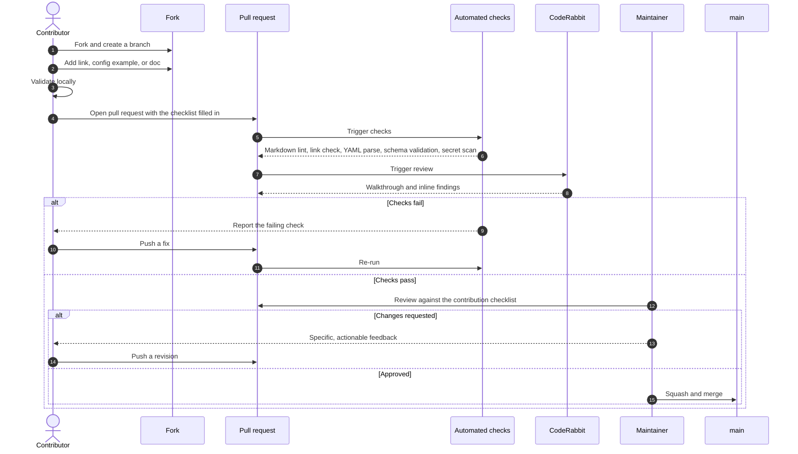
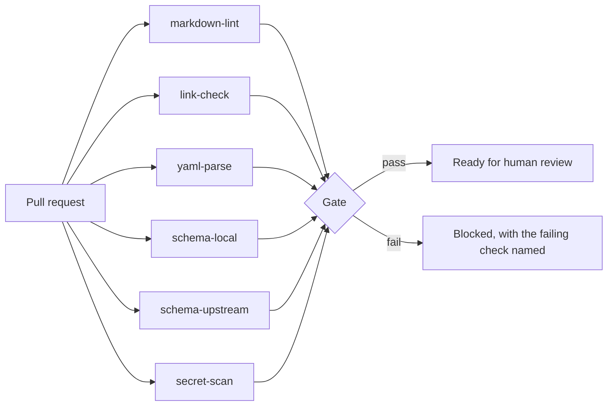
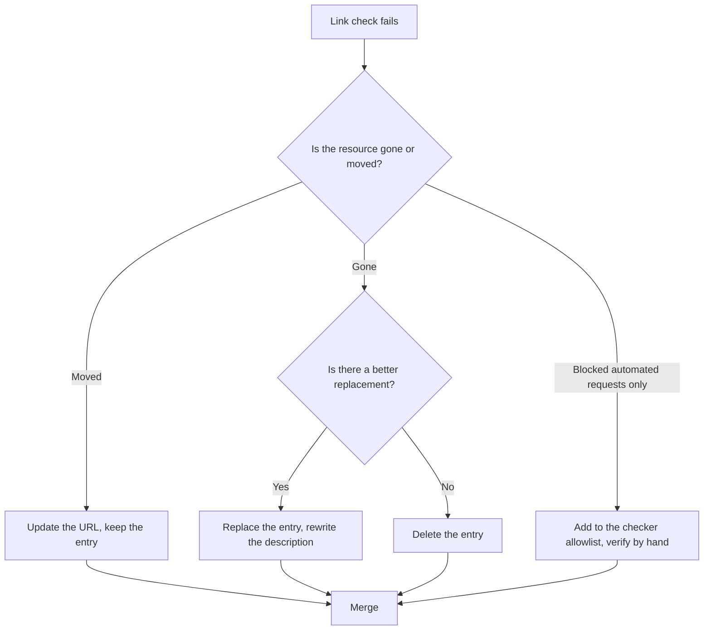

# Workflow

How a change reaches `main`, what is checked automatically, what a human checks, and what happens on a schedule. This is the operational half of [`architecture.md`](architecture.md).

---

## Contribution lifecycle



---

## Local validation before opening a pull request

Run what CI will run. Nothing here requires repository-level tooling to be installed.

| Step | Command | Catches |
| --- | --- | --- |
| YAML parses | `python -c "import sys,yaml;[yaml.safe_load(open(f)) for f in sys.argv[1:]]" configs/*/.coderabbit.yaml` | Indentation and syntax errors |
| Local schema | `check-jsonschema --schemafile schema/coderabbit.config.schema.json configs/*/.coderabbit.yaml` | Typos, wrong enums, unknown keys |
| Upstream schema | `check-jsonschema --schemafile https://coderabbit.ai/integrations/schema.v2.json configs/*/.coderabbit.yaml` | Fields CodeRabbit would actually reject |
| Markdown style | `npx --yes markdownlint-cli2 "**/*.md"` | Heading levels, list spacing, trailing whitespace |
| Links | `npx --yes markdown-link-check README.md` | Dead and redirected links |

Two notes that save time:

- **Blank lines around lists and after headings are required.** CommonMark needs them, and GitHub will render a list as a paragraph without them. This is the single most common lint failure.
- **Validate against both schemas.** The local one catches typos; the upstream one catches fields that do not exist. Passing one does not imply the other.

---

## Automated checks

Six checks run on every pull request. They are independent, so a failure names exactly one problem.



| Check | What it does | Blocking |
| --- | --- | --- |
| `markdown-lint` | Heading hierarchy, list spacing, line style | Yes |
| `link-check` | Every URL in changed Markdown resolves | Yes, with an allowlist for sites that block automated requests |
| `yaml-parse` | Every `.coderabbit.yaml` parses | Yes |
| `schema-local` | Examples validate against the curated schema | Yes |
| `schema-upstream` | Examples validate against `schema.v2.json` | Yes, but tolerant of upstream fetch failure |
| `secret-scan` | No tokens, keys, or internal hostnames | Yes |

### Illustrative pipeline

The following describes the intended pipeline shape. It is documentation, not a committed workflow — a repository whose only content is Markdown and YAML should not carry more automation than it needs.

```yaml
# Illustrative only. Intent: six independent, parallel checks, least privilege,
# actions pinned to a commit SHA.
name: validate

on:
  pull_request:
  schedule:
    - cron: "0 6 * * 1"   # weekly link rot sweep

permissions:
  contents: read

jobs:
  markdown-lint:   # markdownlint-cli2 over **/*.md
  link-check:      # link checker over changed Markdown, with an allowlist
  yaml-parse:      # parse every configs/*/.coderabbit.yaml
  schema-local:    # validate against schema/coderabbit.config.schema.json
  schema-upstream: # validate against https://coderabbit.ai/integrations/schema.v2.json
  secret-scan:     # gitleaks or equivalent over the diff
```

Design rules for the pipeline:

1. **Least privilege.** `permissions: contents: read` at the top level; elevate per job only where required.
2. **Pin actions to a commit SHA.** A moving tag is a supply-chain hole in a repository that anyone can open a pull request against.
3. **Never expose secrets to jobs that process pull request content.** This repository needs no secrets to validate a contribution; keep it that way.
4. **Independent jobs.** Six named failures beat one opaque one.
5. **Tolerate upstream fetch failure.** A CodeRabbit outage should not block a documentation fix. `schema-upstream` warns rather than hard-fails on a network error, and hard-fails on a real validation error.

---

## Human review checklist

Automation cannot judge whether a link is *good*. A maintainer checks:

**For every pull request**

- [ ] The change belongs in this repository, per the non-goals in [`vision.md`](vision.md).
- [ ] Kebab-case naming, correct directory, no stray files.
- [ ] The pull request description says what changed and why.

**For a new link**

- [ ] Opened, read, and current — not merely returning HTTP 200.
- [ ] Placed in exactly one section, the one a reader would look in first.
- [ ] One line of description that says what the reader gets, not what the page is called.
- [ ] Not a duplicate of an existing entry, and better than what it would sit next to.
- [ ] Marketing content is labeled as vendor material where it matters.
- [ ] No affiliate links, no SEO-farm content, no paywalled resource presented as free.

**For a new configuration example**

- [ ] Committable as-is; no placeholders left to fill in.
- [ ] Every non-obvious block has a comment explaining *why*, not what.
- [ ] `path_filters` reflect a real project layout.
- [ ] No secrets, internal hostnames, private repository names, or customer identifiers.
- [ ] No security analyzer disabled and no check set to `off` without a comment justifying it.
- [ ] Both schema checks pass.

**For a documentation change**

- [ ] Behavior is linked, not paraphrased — nothing that will silently go stale.
- [ ] Mermaid diagrams render.
- [ ] Cross-links updated in both directions.
- [ ] Structural changes carry an ADR.

---

## Maintenance cadence

| Cadence | Task |
| --- | --- |
| Every pull request | Automated checks plus human review |
| Weekly | Scheduled link sweep; an issue is opened automatically for each dead link |
| Monthly | Re-read the [CodeRabbit changelog](https://docs.coderabbit.ai/changelog); add new surfaces to the documentation map |
| Quarterly | Review the schema against the upstream reference; prune links that are no longer the best available |
| On upstream schema change | Add newly relevant fields to at least one example, then to the local schema |
| On any structural change | Write the ADR before the change |

---

## Handling a dead link



Dead entries are removed rather than archived. An archived link list is a second list to maintain, and nobody reads it.

---

## Release model

There are no releases. `main` is always the published state, and GitHub renders it directly. Consequences worth stating:

- Every merge is a release, so `main` must never be broken.
- No changelog file. The commit history and pull request titles are the changelog.
- No version numbers on the schema. It is versioned by the repository's history; breaking changes to it land with an ADR.

---

## Related documents

- [`architecture.md`](architecture.md) — Layers, boundaries, and dependency rules.
- [`configuration-guide.md`](configuration-guide.md) — Field reference for the examples.
- [`build-plan.md`](build-plan.md) — Building the repository from an empty directory.
- [`../CONTRIBUTING.md`](../CONTRIBUTING.md) — The contributor-facing version of this workflow.
